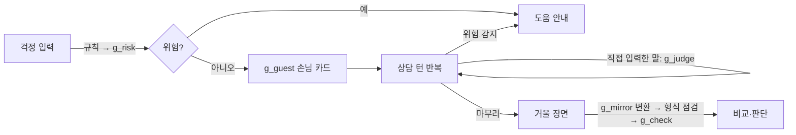

# AI 설계 (거울상담소)

게임 한 판에서 AI가 하는 일, 어디를 고치면 무엇이 바뀌는지를 정리한 문서입니다. API 사용법은 [api.md](api.md), 요구사항별 구현·검증 상태는 [requirements.md](requirements.md)를 보세요.

## 한 판의 흐름과 AI 호출

| 호출 종류 | 하는 일 | 프롬프트 | 요구사항 |
|---|---|---|---|
| `g_risk` | 걱정 입력의 위험 판정 (규칙에 안 걸린 경우만) | `content/prompts/risk/` | FR-10 |
| `g_guest` | 걱정을 닮은 손님 카드 + 첫 선택지. 실패하면 1회 재시도 후 예시 손님 | `content/prompts/guest/` | FR-03 |
| `g_turn` | 손님 대사 + 선택지 2~3개 + 새로 알게 된 사실 + 플레이어 발화의 위험 여부 (한 번의 호출) | `content/prompts/turn/` | FR-04, FR-10, NFR-01 |
| `g_judge` | 직접 입력한 말이 조언인지 판정: `ok`·`not_advice`·`blame`·`risk` | `content/prompts/judge/` | FR-06 |
| `g_mirror` | 고른 조언을 플레이어 자신에게 하는 말로 변환 | `content/prompts/mirror/` | FR-08 |
| `g_check` | 변환문의 의미 점검: 반전·내용 추가·강요(새 당위·선택 삭제·결심 생성) | `content/prompts/check/` | FR-08, NFR-03 |
| `g_player`, `g_context` | 테스트 도구 전용: 가상 플레이어, 맥락 유지 판정 | `content/prompts/player/`, `context/` | 4-2절 |

### 거울 장면 (FR-08, NFR-03)
1. `g_mirror`로 변환
2. 형식 점검(규칙, `src/game/format.js`): 빈 출력, 2인칭 남음, 지나친 길이 증가 + 금지 표현
3. `g_check`로 의미 점검
4. 실패하면 한 번 다시 변환 → 또 실패하면 변환문 없이 **원문만** 보여 줌

점검을 통과하지 못한 문장은 플레이어에게 보이지 않습니다.

### 안전 장치
- **위험 규칙** (`content/safety/rules.json`): AI보다 먼저 검사. 걸리면 AI를 부르지 않고 바로 도움 안내
- **AI 위험 판정**: 걱정(`g_risk`), 매 턴 발화(`g_turn`의 `player_risk`), 조언 판정(`g_judge`의 `risk`), 비교·판단의 수정 문장(규칙)
- **금지 표현** (`game.json`의 `banned_words`: 치료·효과·진행률): 손님 카드·대사·선택지·변환문에 나오면 형식 오류로 보고 다시 생성
- **판당 호출 상한** (`game.json`의 `limits`): 60회, 그중 4회는 거울 장면용으로 남겨 둠
- **로그**: `data/game/logs/`에는 원문 없이 호출 종류·모델·시간·토큰·실패 사유만 기록 (NFR-04)

## 고치는 곳

| 바꾸고 싶은 것 | 파일 |
|---|---|
| 손님 말투·성격, 선택지 스타일 | `content/prompts/guest/v1.md`, `turn/v1.md` |
| 조언 판정 기준 | `content/prompts/judge/v1.md` |
| 변환 방식, 점검 기준 | `content/prompts/mirror/v1.md`, `check/v1.md` |
| 동의 문구, 예시 걱정, 턴 수, 호출 상한, 도움 안내 문구 | `content/game.json` |
| 예시 손님 (AI 실패 시 대체) | `content/guests/examples.json` |
| 위험·비난 규칙 | `content/safety/rules.json` |
| 출력 형식 검사 | `src/game/judges.js` + 각 프롬프트 폴더의 `schema.json` |
| 상담 진행 규칙 (조언 요청 턴, 마무리 제안, 자동 종료) | `src/game/flow.js` |

콘텐츠와 프롬프트는 요청마다 다시 읽으므로 서버를 재시작하지 않아도 바로 반영됩니다.

**프롬프트를 크게 바꿀 때**는 기존 파일을 고치지 말고 `v2.md`를 새로 만든 뒤 `.env`의 `GAME_PROMPT_VERSION=v2`로 바꿔 비교하세요. 세션 기록에 프롬프트 버전과 해시가 남습니다. 바꾼 뒤에는 `npm run risk`와 `npm run sim`으로 다시 확인합니다.

## 모의(mock) 모드
키가 없으면 AI 대신 정해진 가짜 응답을 씁니다(`src/game/mocks.js`). 내용은 의미 없지만 앱 화면과 흐름을 끝까지 시험할 수 있습니다. 입력에 태그를 붙이면 특정 경로로 보낼 수 있습니다.

| 태그 | 어디에 | 결과 |
|---|---|---|
| `#risk` | 걱정·발화 | 도움 안내 |
| `#notadvice`, `#blame` | 직접 입력한 말 | 조언 판정 결과 |
| `#error`, `#slow` | 발화 | AI 오류·시간 초과 → 503 `AI_RETRY` |
| `#guestbad` | 걱정 | 손님 생성 실패 → 예시 손님 |
| `#mirrorfail` | 하이라이트가 될 조언 | 점검 실패 → 원문만 |
| `#banned` | 발화 | 금지 표현이 섞인 대사 → 재생성 |

전체 목록은 `src/game/mocks.js` 맨 위에 있습니다.
